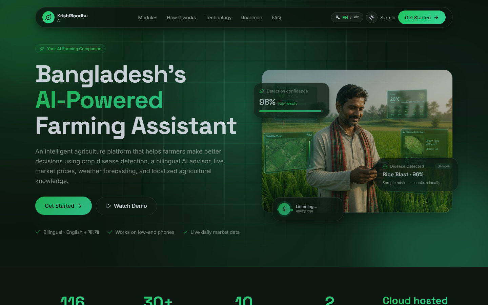

<p align="center">
  
</p>

<h1 align="center">KrishiBondhu AI</h1>

<p align="center">
  <strong>Your farming companion in Bangla and English.</strong><br />
  Check a crop photo, ask a question, and plan your next step.<br />
  Built for Bangladesh by <strong>Team PentaFarmers</strong>.
</p>

<p align="center">
  <a href="https://krishibondhu-ai-web.vercel.app"></a>
  <a href="https://github.com/ausabbir76/Krsishi-Bondhu-AI-App/releases/download/V1/Krishi-Bondhu-AI-arm64-v8a.apk"></a>
  <a href="https://www.youtube.com/watch?v=KZEimU8eRxo"></a>
</p>

<p align="center">
  <a href="#features">Features</a> &middot;
  <a href="#android-app">Android App</a> &middot;
  <a href="#for-developers">Developer Setup</a> &middot;
  <a href="https://github.com/ausabbir76/Krsishi-Bondhu-AI-App">Mobile Source</a> &middot;
  <a href="https://hodoly163-krishibondhu-api.hf.space/docs">API Docs</a>
</p>

## From A Photo To A Next Step

1. **Show or ask.** Upload a clear crop photo, or ask a farming question in Bangla or English.
2. **Understand.** Get a possible disease identification and practical advice; check weather and market information alongside it.
3. **Decide.** Use the guidance to plan, and confirm important treatments with a local agricultural adviser.

<p align="center">
  <a href="https://krishibondhu-ai-web.vercel.app"></a>
</p>

<p align="center"><sub>Web landing-page preview. The diagnosis shown in the page is labeled sample data, not a live test result.</sub></p>

## Features

<table>
  <tr>
    <td width="50%" valign="top">
      <h3>01 / Crop Disease Scan</h3>
      <p>Upload a crop photo. KrishiDrishti-11X checks 116 disease and health classes and returns detection boxes, confidence scores, and bilingual advice.</p>
      <a href="https://hodoly163-krishibondhu-demo.hf.space">Try a crop photo &rarr;</a>
    </td>
    <td width="50%" valign="top">
      <h3>02 / Farming Advisor</h3>
      <p>Ask in Bangla or English. The web client can include your selected district's weather and market context in the conversation.</p>
      <a href="https://krishibondhu-ai-web.vercel.app">Open the assistant &rarr;</a>
    </td>
  </tr>
  <tr>
    <td valign="top">
      <h3>03 / Weather And Prices</h3>
      <p>District forecasts from OpenWeather and national retail prices from DAM. Check each price row's source and date before making a decision.</p>
    </td>
    <td valign="top">
      <h3>04 / Seasonal Guidance</h3>
      <p>Planting and harvesting calendars, plus general or regional soil guidance. Soil guidance is not a laboratory test.</p>
    </td>
  </tr>
</table>

**Before you rely on a result:** AI can be wrong, and a confidence score is not a guarantee. Confirm serious crop problems and chemical treatments with a qualified agricultural adviser and follow the product label. Satellite and soil-analysis API responses are previews, not live satellite measurements or lab results.

**Connection and startup:** AI requests need internet. Free hosting may take a minute or two to wake; detection can take longer while the model loads. Wait and retry during startup. If live market data is unavailable, cached or dated fallback rows are shown instead of being presented as today's prices.

## Android App

| Get the app | Explore the project |
|---|---|
| [**Download V1 ARM64 APK**](https://github.com/ausabbir76/Krsishi-Bondhu-AI-App/releases/download/V1/Krishi-Bondhu-AI-arm64-v8a.apk) | [**Flutter source repository**](https://github.com/ausabbir76/Krsishi-Bondhu-AI-App) |
| [Latest release and other builds](https://github.com/ausabbir76/Krsishi-Bondhu-AI-App/releases/latest) | [Mobile setup and documentation](https://github.com/ausabbir76/Krsishi-Bondhu-AI-App#readme) |

1. Download the **ARM64 APK** for most recent Android phones.
2. Open the APK. If Android asks, allow installation from your browser or file manager only for this installation.
3. Open the app. Allow microphone access if you want voice input.

The separately maintained Flutter source includes crop scans, chat, weather, market prices, and Bangla/English voice input and output. Voice support depends on the device's speech services and languages. The [V1 release](https://github.com/ausabbir76/Krsishi-Bondhu-AI-App/releases/tag/V1) also has an x86 APK for compatible devices or emulators; no iOS download is linked here. **The released APK may differ from the latest source.**

## For Developers

This repository contains the web app and backend. Mobile development lives in the [separate Flutter repository](https://github.com/ausabbir76/Krsishi-Bondhu-AI-App).

<details>
<summary><strong>Run the web app with hosted AI</strong></summary>

Install [Git](https://git-scm.com/) and [Bun](https://bun.sh/). No local AI model is needed for this mode.

```sh
git clone https://github.com/Shadman-Samin/KrishiBondhuAIWeb.git
cd KrishiBondhuAIWeb/KrishiBondhuWeb
bun install
```

Create `KrishiBondhuWeb/.env.local` from [.env.example](KrishiBondhuWeb/.env.example) and configure:

```dotenv
VITE_BACKEND=space
VITE_SPACE_URL=https://hodoly163-krishibondhu-demo.hf.space
VITE_OPENWEATHER_API_KEY=your_openweather_key
```

If your checkout includes Firebase sign-in, configure its `VITE_FIREBASE_*` settings using the [frontend authentication guide](KrishiBondhuWeb/README.md#authentication-firebase-auth). That dashboard requires the Firebase configuration before sign-in is available. Do not assume authentication changes in a development checkout are already deployed.

```sh
bun run dev
```

Open **http://localhost:8080**. Weather requires an OpenWeather key. Keep local environment files and provider credentials out of Git.

</details>

<details>
<summary><strong>Run the Python backend locally</strong></summary>

Use Python 3.10. From `KrishiBondhuVision/`, run in Windows PowerShell:

```powershell
python -m venv .venv
.\.venv\Scripts\python.exe -m pip install -r requirements.txt
.\.venv\Scripts\python.exe -m uvicorn api.server:app --host 127.0.0.1 --port 8000
```

Detection weights download from Hugging Face when first needed. Configure `ADVISE_URL`, `ADVISE_MODEL`, `ADVISE_API_KEY`, and the hosted/local `ADVISE_HOSTED` mode in the backend's local `.env`; weather uses `OPENWEATHER_API_KEY`. See the [model runtime guide](KrishiBondhuVision/MODELS.md).

Set `VITE_BACKEND=fastapi` in the frontend environment and restart `bun run dev`. Vite forwards API requests to port 8000.

The root [start-dev.bat](start-dev.bat) is an alternative for an already configured Windows stack. It builds the web app, starts SSR and FastAPI, and opens an ngrok tunnel. It assumes local tools and LLM settings are ready and stops processes on its configured ports; inspect it before use.

</details>

<details>
<summary><strong>Architecture and repository map</strong></summary>

```text
Web app on Vercel ----> Gradio AI demo on Hugging Face Spaces
Flutter mobile app --> FastAPI REST API on Hugging Face Spaces
```

Both hosted services use the crop vision model and a language model for advice. Detection tries GPU processing and can fall back to CPU. Weather comes from OpenWeather; market data comes from DAM.

The REST backend's additional capabilities include curated agronomy retrieval, a fixed LangGraph advice workflow, and price-history tools. Chroma vectors are lexical TF-IDF; Kuzu's graph is manually curated; DuckDB stores price snapshots. The experimental trend endpoint needs at least three dated observations. These capabilities are separate from the public web app's Gradio path. n8n snapshots and Ollama models have been exercised locally, not scheduled or served in production.

| Path | Responsibility |
|---|---|
| [KrishiBondhuWeb/](KrishiBondhuWeb/) | TanStack Start, React, and Tailwind web client. |
| [KrishiBondhuVision/](KrishiBondhuVision/) | FastAPI, detection, retrieval, market data, and evaluation scripts. |
| [space-demo/](space-demo/) | Gradio AI service used by the web. |
| [space-api/](space-api/) | Hosting glue for the mobile/integrator REST service. |
| [mcp-server/](mcp-server/) | Read-only market tools for MCP clients. |
| [docs/](docs/) | API contracts and deployment/project documentation. |

For mobile work, use its separate repository rather than any local mobile snapshot here.

</details>

## Project Resources

| Explore | Link |
|---|---|
| Try the vision model and advisor directly | [Interactive AI demo](https://hodoly163-krishibondhu-demo.hf.space) |
| Integrate with the REST backend | [Swagger API docs](https://hodoly163-krishibondhu-api.hf.space/docs) and [mobile API contract](docs/API_FOR_APP.md) |
| Develop or deploy the web app | [Frontend guide](KrishiBondhuWeb/README.md) and [deployment notes](docs/DEPLOY.md) |
| Understand the model and its limits | [Vision model card](https://huggingface.co/hodoly163/krishibondhu-jktk) |
| Connect an MCP client | [MCP tools and usage guide](mcp-server/MCP.md) |

## License

Our application code is proprietary: all rights reserved. The vision model is an AGPL-3.0-licensed Ultralytics YOLO11x derivative; see the [model card](https://huggingface.co/hodoly163/krishibondhu-jktk). Third-party software retains its respective licenses. See the mobile repository for its licensing information.

<p align="center"><sub>Team PentaFarmers &middot; Built for Bangladesh's farms, seasons, and decisions.</sub></p>
